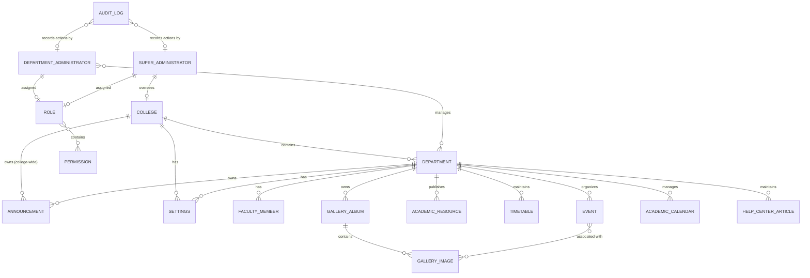

# Entity Relationship Diagram

**Status**: Draft

## 1. Purpose
This document defines the conceptual Entity Relationship Diagram (ERD) for Version 1 of the Campus Department Management System (CDMS). It describes the entities, their relationships, and cardinality in a technology-independent manner, based on the approved business domain and conceptual database design.

## 2. Scope
This ERD covers all approved Version 1 business entities and their relationships. It excludes any entities planned for future versions.

## 3. Entities
The following entities are included in the Version 1 conceptual ERD:

- College
- Department
- Faculty Member
- Announcement
- Event
- Academic Resource
- Timetable
- Gallery Album
- Gallery Image
- Academic Calendar
- Help Center Article
- Settings
- Audit Log
- Role
- Permission
- Department Administrator
- Super Administrator

## 4. Relationships

### College → Department
- **Source Entity**: College
- **Target Entity**: Department
- **Relationship Description**: A College contains multiple Departments.
- **Cardinality**: One-to-Many
- **Business Justification**: A college is composed of multiple academic departments.

### Department → Faculty Member
- **Source Entity**: Department
- **Target Entity**: Faculty Member
- **Relationship Description**: A Department has multiple Faculty Members.
- **Cardinality**: One-to-Many
- **Business Justification**: Faculty members are affiliated with a specific department.

### Department → Announcement
- **Source Entity**: Department
- **Target Entity**: Announcement
- **Relationship Description**: A Department owns multiple Announcements.
- **Cardinality**: One-to-Many
- **Business Justification**: Departments publish their own announcements.

### College → Announcement
- **Source Entity**: College
- **Target Entity**: Announcement
- **Relationship Description**: A College can own college-wide Announcements.
- **Cardinality**: One-to-Many
- **Business Justification**: The college can publish system-wide announcements.

### Department → Event
- **Source Entity**: Department
- **Target Entity**: Event
- **Relationship Description**: A Department organizes multiple Events.
- **Cardinality**: One-to-Many
- **Business Justification**: Events are managed at the department level.

### Department → Academic Resource
- **Source Entity**: Department
- **Target Entity**: Academic Resource
- **Relationship Description**: A Department publishes multiple Academic Resources.
- **Cardinality**: One-to-Many
- **Business Justification**: Academic materials are owned by departments.

### Department → Timetable
- **Source Entity**: Department
- **Target Entity**: Timetable
- **Relationship Description**: A Department maintains its own Timetables.
- **Cardinality**: One-to-Many
- **Business Justification**: Timetables are department-specific.

### Department → Gallery Album
- **Source Entity**: Department
- **Target Entity**: Gallery Album
- **Relationship Description**: A Department owns multiple Gallery Albums.
- **Cardinality**: One-to-Many
- **Business Justification**: Visual content is organized by department.

### Gallery Album → Gallery Image
- **Source Entity**: Gallery Album
- **Target Entity**: Gallery Image
- **Relationship Description**: A Gallery Album contains multiple Gallery Images.
- **Cardinality**: One-to-Many
- **Business Justification**: Images are grouped into albums.

### Event → Gallery Image
- **Source Entity**: Event
- **Target Entity**: Gallery Image
- **Relationship Description**: An Event may be associated with multiple Gallery Images.
- **Cardinality**: Many-to-Many
- **Business Justification**: Events can be illustrated with multiple images from different albums.

### Department → Academic Calendar
- **Source Entity**: Department
- **Target Entity**: Academic Calendar
- **Relationship Description**: A Department manages its own Academic Calendar.
- **Cardinality**: One-to-Many
- **Business Justification**: Academic dates are maintained at the department level.

### Department → Help Center Article
- **Source Entity**: Department
- **Target Entity**: Help Center Article
- **Relationship Description**: A Department maintains multiple Help Center Articles.
- **Cardinality**: One-to-Many
- **Business Justification**: Support content is provided per department.

### College → Settings
- **Source Entity**: College
- **Target Entity**: Settings
- **Relationship Description**: A College has its own Settings.
- **Cardinality**: One-to-Many
- **Business Justification**: College-level configuration is independent.

### Department → Settings
- **Source Entity**: Department
- **Target Entity**: Settings
- **Relationship Description**: A Department has its own Settings.
- **Cardinality**: One-to-Many
- **Business Justification**: Departments can have independent configuration.

### Department Administrator → Department
- **Source Entity**: Department Administrator
- **Target Entity**: Department
- **Relationship Description**: A Department Administrator manages one or more Departments.
- **Cardinality**: Many-to-Many
- **Business Justification**: Administrators can be assigned to multiple departments.

### Super Administrator → College
- **Source Entity**: Super Administrator
- **Target Entity**: College
- **Relationship Description**: Super Administrators oversee the College.
- **Cardinality**: Many-to-One
- **Business Justification**: Super Administrators have system-wide responsibility.

### Department Administrator → Role
- **Source Entity**: Department Administrator
- **Target Entity**: Role
- **Relationship Description**: A Department Administrator is assigned one Role.
- **Cardinality**: Many-to-One
- **Business Justification**: Access rights are granted through roles.

### Super Administrator → Role
- **Source Entity**: Super Administrator
- **Target Entity**: Role
- **Relationship Description**: A Super Administrator is assigned one Role.
- **Cardinality**: Many-to-One
- **Business Justification**: Access rights are granted through roles.

### Role → Permission
- **Source Entity**: Role
- **Target Entity**: Permission
- **Relationship Description**: A Role contains multiple Permissions.
- **Cardinality**: Many-to-Many
- **Business Justification**: Roles are composed of granular permissions.

### Audit Log → Department Administrator
- **Source Entity**: Audit Log
- **Target Entity**: Department Administrator
- **Relationship Description**: Audit Logs record actions performed by Department Administrators.
- **Cardinality**: Many-to-One
- **Business Justification**: Administrative actions must be traceable.

### Audit Log → Super Administrator
- **Source Entity**: Audit Log
- **Target Entity**: Super Administrator
- **Relationship Description**: Audit Logs record actions performed by Super Administrators.
- **Cardinality**: Many-to-One
- **Business Justification**: Administrative actions must be traceable.

## 5. Relationship Rules

- A Faculty Member must belong to exactly one Department.
- An Announcement must belong to either one Department or the College.
- A Gallery Image must belong to exactly one Gallery Album.
- An Event may be associated with multiple Gallery Images across different albums.
- Settings must be unique within their scope (College or Department).
- A Department Administrator must be assigned to at least one Department.
- Audit Logs must record actions performed by administrators.
- Roles and Permissions define access control across all administrative functions.

## 6. Conceptual ER Diagram

## 7. Open Questions

- Should the many-to-many relationship between Event and Gallery Image be modeled through a direct association or through Gallery Album only?
- How should the relationship between Academic Calendar and Event be represented if they need to be linked?
- Should Settings have a more structured relationship with specific entities beyond simple key-value scope?

---

**Document Version**: 1.0  
**Status**: Draft  
**Last Updated**: 2026-07-23  
**Depends On**: DOMAIN_MODEL.md, DATABASE_DESIGN.md  
**Referenced By**: Future implementation documents